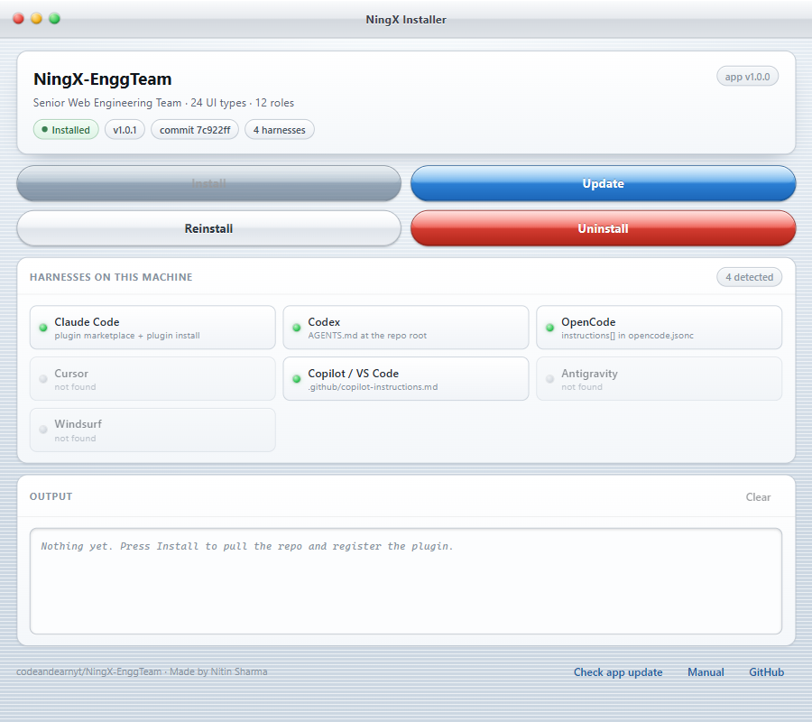

<div align="center">




<br />

[](CHANGELOG.md)
[](agents)
[](skills)
[](desktop)
[](LICENSE)

<br />


</div>

<br />

<table>
<tr>
<td width="260" align="center" valign="middle">


**Nitin Sharma**
<sub>Developer & maintainer</sub>

[](https://github.com/codeandearnyt)

</td>
<td valign="middle">

### A senior web engineering team for AI coding harnesses

Twelve roles. Twenty-four named UI types, each with a reference site and a loadable skill. Seven craft skills. Eight always-loaded rule files. One write-time guard that blocks the mechanical violations before they land on disk.

The point is not to describe good web work. **The point is to make a model produce it, and to fail the build when it doesn't.**

**[Read the manual →](USE.md)**

</td>
</tr>
</table>

<div align="center">

</div>

## The problem this solves

Given no direction, generated interfaces converge. The same dark gradient hero, the same three feature cards, the same Inter at 16px, the same `border-radius: 12px`, the same *"Elevate your workflow."*

That convergence is not a model failure. It is a **direction failure**. Nothing in the prompt said *what kind of page this is*, so the model produced the average of every page it has seen.

This repo fixes it at three layers:

| Layer | Mechanism | When it acts |
|---|---|---|
| **Rules** | `rules/*.md` loaded every session | Before any code is written |
| **Skills** | `skills/*/SKILL.md` loaded on demand, with self-check blocks | While the work is happening |
| **Guard** | `hooks/ui-guard.py` on `PreToolUse` | At the moment of the write |

Plus twelve agent roles that own specific decisions, and seven commands that run the workflows.

<div align="center">

</div>

## What is inside

```
AGENTS.md                 the constitution — every skill and agent inherits it
DESIGN-LAW.md             the 24-type catalog with reference sites and mixing rules
VERSION                   1.0.2

agents/                   12 senior roles
  web-architect             routes, rendering strategy, UI type per page
  frontend-lead             components, state, four list states
  backend-lead              endpoints, validation, authorization, migrations
  ui-ux-director            palette, type pairing, composition, anti-slop verdict
  design-system-engineer    three-layer tokens, component library, dark mode
  motion-engineer           durations, easings, scroll motion, reduced-motion
  webgl-engineer            WebGL/WebGPU, shaders, Three.js, XR, fallbacks
  accessibility-lead        WCAG 2.2 AA, contrast, keyboard, focus
  performance-engineer      LCP, CLS, INP, bundle budget
  qa-lead                   width ladder, four states, keyboard pass, verdict
  code-reviewer             correctness, security, data integrity, craft
  seo-engineer              semantics, metadata, structured data, crawlability

skills/                   24 UI types + 7 craft skills
  ui-01-terminal-cli        ycombinator.com
  ui-02-wireframe           balsamiq.com
  ui-03-brutalist-html      berkshirehathaway.com
  ui-04-pure-flat           mailchimp.com
  ui-05-swiss-grid          aesop.com
  ui-06-editorial-typographic  bloomberg.com
  ui-07-line-art-handdrawn  notion.so
  ui-08-neobrutalism        gumroad.com
  ui-09-card-masonry        pinterest.com
  ui-10-bento-grid          linear.app
  ui-11-material-elevated   google.com
  ui-12-layered-dark        vercel.com
  ui-13-aurora-mesh-gradient  stripe.com
  ui-14-glassmorphism       apple.com
  ui-15-neumorphism         neumorphism.io
  ui-16-retro-y2k           poolsuite.net
  ui-17-claymorphism        pitch.com
  ui-18-skeuomorphism       teenage.engineering
  ui-19-isometric           icograms.com
  ui-20-parallax            firewatchgame.com
  ui-21-scrollytelling-kinetic  pudding.cool
  ui-22-embedded-3d         spline.design
  ui-23-webgl-shader        lusion.co
  ui-24-spatial-webxr       bruno-simon.com

  design-system-tokens      primitive → semantic → component, dark mode remap
  accessibility-wcag        WCAG 2.2 AA, measured
  web-performance           Core Web Vitals, the five highest-leverage fixes
  responsive-layout         intrinsic layouts, container queries, the width ladder
  frontend-architecture     folder boundaries, state placement, four list states
  backend-architecture      validation, authorization, errors, pagination, migrations
  anti-slop-review          the 24-check audit with a PASS/FAIL verdict

rules/                    8 always-loaded files
  design-quality.md        the visual bar
  anti-slop.md             the banned patterns list
  frontend-craft.md        components, state, data fetching
  backend-craft.md         layering, validation, authorization, migrations
  accessibility.md         contrast, focus, semantics, motion, target size
  performance.md           budgets and the rules that keep a page inside them
  security.md              injection, XSS, secrets, redirects, uploads
  README.md                the precedence order and the hard-fail set

hooks/
  hooks.json               PreToolUse + SessionStart wiring
  ui-guard.py              blocks the mechanical violations, exit 2
  session-brief.py         prints the roster and the type index at session start

commands/                 7 workflows
  /build-page              type → direction block → build → audit → numbers
  /audit-page              24 checks + a11y + width ladder + performance
  /pick-ui-type            one recommendation with a reason and a cost
  /design-tokens           three layers, dark mode, contrast verified
  /review-diff             severity-ranked findings, APPROVE or REQUEST CHANGES
  /ship-check              every gate, SHIP or DO-NOT-SHIP
  /new-project             structure, tokens, lint, CI, first page

references/
  ui-types.md              the 24-type index with signatures and mixing rules
  checklists.md            copy-paste gates for every stage

docs/
  install.md               per-harness setup
  harnesses.md             what loads where
  faq.md                   the questions this design invites
```

<div align="center">

</div>

## The ten non-negotiables

Enforced by the guard where mechanically possible, by review where not.

1. **Every page names its UI type** in a file comment. One structural, at most one surface. Three is a fail.
2. **No hex literal in a component.** Tokens only. Hex lives in `tokens.css`.
3. **No `outline: none`** without a replacement focus style.
4. **No image without `width`, `height`, and `alt`.**
5. **No `transition: all`.** Name the properties.
6. **No animation without a `prefers-reduced-motion` path** in CSS and JS.
7. **No input without an associated `<label for>`.**
8. **No emoji as an icon.** No placeholder images. No `href="#"`.
9. **No banned marketing copy** — elevate, unlock, seamless, empower, and the rest.
10. **No "done" without a check.** Numbers, not adjectives.

<div align="center">

</div>

## Install

### Claude Code

```bash
claude plugin marketplace add /absolute/path/to/NingX-EnggTeam
claude plugin install ningx-enggteam@ningx
```

Everything loads: agents, skills, rules, commands, hooks.

### Everything else

Codex, OpenCode, Cursor, Copilot, Windsurf, Antigravity, Qoder, or any harness that accepts a system prompt — see [`docs/install.md`](docs/install.md) and [`docs/harnesses.md`](docs/harnesses.md).

The short version: paste `AGENTS.md` into the system prompt, and paste `skills/ui-NN-*/SKILL.md` when a page needs a specific type.

<div align="center">

</div>

## Desktop app

If you would rather click than type. One Aqua window, the same on Windows, macOS, and Linux.

<div align="center">

</div>

Four buttons — **Install**, **Update**, **Reinstall**, **Uninstall**. It clones this repo into `~/.ningx-desktop`, registers the marketplace, and installs the plugin. Update pulls from GitHub on every press.

```bash
cd desktop
npm install
npm run build
npm start
```

Build the installers with `npm run dist:win`, `dist:mac`, or `dist:linux`. CI builds all three on a tag push.

**[Download the installer →](https://github.com/codeandearnyt/NingX-EnggTeam/releases/latest)** — `.exe`, `.dmg` (Intel + Apple Silicon), `.AppImage`, `.deb`.

<div align="center">

</div>

## Use

```
/pick-ui-type  pricing page for a dev tool, three tiers, annual toggle

  RECOMMENDATION — /pricing
  Structural: 05-swiss-grid
  Reference:  aesop.com
  Reason:     three tiers is a small, comparable set; sparse content
              and a strict grid make the comparison the design
  Cost:       needs genuinely sparse content — dies with filler
  Surface:    11-material-elevated, the tier cards only
  Rejected:   10-bento (cells would be arbitrary),
              09-masonry (nothing to browse)

  Load: skills/ui-05-swiss-grid, skills/ui-11-material-elevated
```

```
/build-page  pricing page, three tiers, annual toggle

  ... builds it, writes the ui-type comment, runs the anti-slop pass ...

  PAGE: /pricing
  UI type: 05 (structural) + 11 (surface)
  Anti-slop: PASS
  LCP 1.2s · CLS 0.00 · INP 60ms · JS 74KB gz
  Widths checked: 320 / 768 / 1440 / 2560
  Keyboard: pass · Reduced motion: pass
```

```
/ship-check  pricing

  Mechanical:      PASS (0 hits)
  Anti-slop:       PASS
  Accessibility:   PASS (axe 0 critical, keyboard pass)
  Performance:     LCP 1.2s · CLS 0.00 · INP 60ms · JS 74KB gz
  Responsive:      PASS (8 widths + 200% zoom)
  Reduced motion:  PASS

  VERDICT: SHIP
```

<div align="center">

</div>

## The mixing rule

Two types maximum. One structural, one surface.

| Valid | Why |
|---|---|
| `09-card-masonry` + `13-aurora` | Aurora as a hero band above a masonry feed |
| `05-swiss-grid` + `20-parallax` | One parallax image section inside a Swiss grid |
| `12-layered-dark` + `14-glassmorphism` | Glass nav over a dark console |
| `10-bento-grid` + `17-claymorphism` | Clay cells inside a bento frame |

| Invalid | Why |
|---|---|
| `08-neobrutalism` + `15-neumorphism` | Opposite light models |
| `11-material` + `17-claymorphism` | Two competing depth systems |
| `03-brutalist-html` + anything | Brutalism is the absence of style |
| `05-swiss-grid` + `10-bento-grid` | Two structural systems fighting |

<div align="center">

</div>

## The anti-slop gate

Twenty-four checks. All must pass. A single FAIL blocks the ship.

**Structure (4) · Color (4) · Type (5) · Space (3) · Shape (3) · Content (4) · Motion (3) · Craft (4)**

The most reliable single detector:

> Are there three identical cards in a row, each with an icon, a heading, and two lines of text?

If yes: do those three things genuinely have equal importance and equal shape? If the answer is not an immediate yes, the row is a default, not a decision.

<div align="center">

</div>

## The guard

`hooks/ui-guard.py` runs on every write and exits `2` on a violation. Verified against nine cases:

| Input | Result |
|---|---|
| `` | blocked — A11Y-07 |
| `` | allowed |
| `.x{transition:all .3s;outline:none;background:#f5f5f5}` | blocked — PERF-01, A11Y-02, UI-04 |
| `tokens.css` with `--ink:#111` | allowed |
| `<h1>Elevate your workflow</h1>` | blocked — SLOP-01 |
| three `ui-type:` comments | blocked — UI-01 |
| five distinct `border-radius` values, `strict` profile | blocked — STYLE-01 |
| `hook_profile=minimal`, `href="#"` | allowed — not a non-negotiable |
| `hooks_enabled=false`, `` | allowed — guard disabled |

An internal error in the guard always returns `0`. A guard bug must never break a session.

Two options control it: `hooks_enabled` and `hook_profile` (`minimal` / `standard` / `strict`). See [`USE.md` §9](USE.md#9-the-guard--what-it-blocks).

<div align="center">

</div>

## The precedence order

```
AGENTS.md          the constitution
DESIGN-LAW.md      the 24-type catalog
rules/             the always-loaded rules
skills/            the on-demand detail
agents/            the role definitions
```

A rule never overrides the constitution. A skill never overrides a rule. An agent never overrides a skill.

<div align="center">

</div>

## What this is not

- Not a component library. It ships no npm package.
- Not a template. Every scaffold is a starting point that names its type and its tokens.
- Not a replacement for taste. It removes the defaults so the choice is visible; the choice is still yours.

<div align="center">

</div>

## License

**NingX-EnggTeam License v1.0 — Attribution & No-Rebranding.**

You can use it, modify it, build client work with it, and ship sites with it — those sites are entirely yours, no attribution needed on them.

You cannot rename it, remove **"Made by Nitin Sharma"**, or publish it under a different brand without written permission.

Full terms in [`LICENSE`](LICENSE). Permission requests: [open an issue](https://github.com/codeandearnyt/NingX-EnggTeam/issues).

This is a custom source-available license, not OSI-approved open source.

<br />

<div align="center">


<sub>Built by <a href="https://github.com/codeandearnyt">Nitin Sharma</a> · the animated banners are generated by <a href="assets/readme/generate.mjs"><code>assets/readme/generate.mjs</code></a></sub>

</div>
